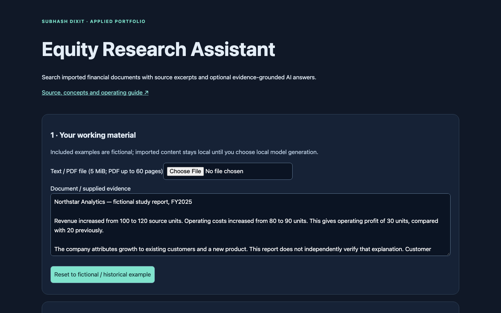
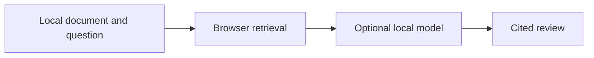
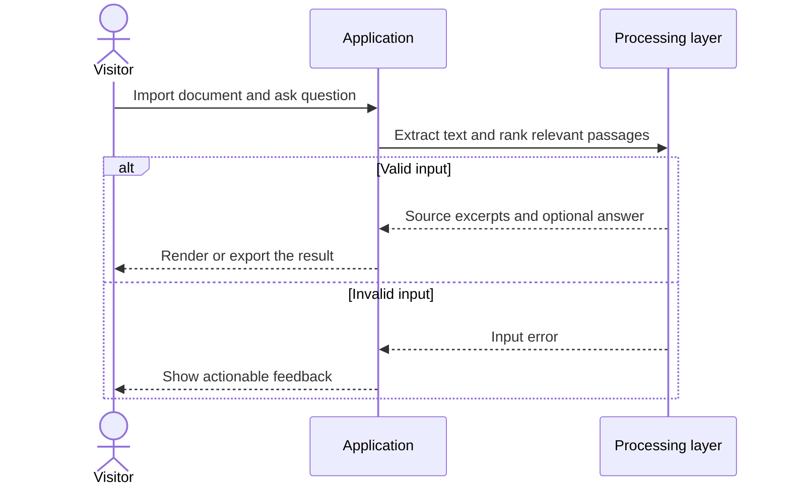
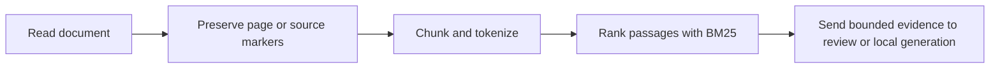
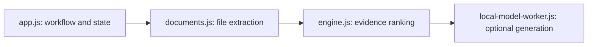
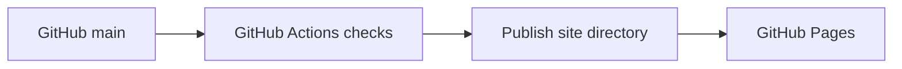

# Equity Research Assistant

## 1. Project overview

Find evidence in financial documents and optionally generate an answer grounded in retrieved excerpts. The repository combines local document reading, passage ranking, and browser-based generation with source references.

[Live demo](https://subhashdixit.github.io/equity-research-assistant/) · [Source repository](https://github.com/subhashdixit/equity-research-assistant)



## 2. Motivation and problem statement

### Objective

Help a researcher find source passages that address a financial question and use those passages to check an optional generated answer.

### Problem statement

Given a supported document and a question, identify relevant excerpts within long or unevenly structured material. A result should show which passages it used so a reader can verify figures and claims in context.

### Motivation

Searching filings or research notes manually takes time, and a generated summary can make claims that are hard to trace. This project keeps excerpts available alongside the answer, with deterministic retrieval for users who only need the evidence. Its separate news reader can bring in supported public feeds.

## 3. Solution and scope

Import supported text or PDF, ask a question, and inspect ranked source excerpts. Optional local generation uses the retrieved evidence. A fixed-source news reader can fetch public feeds through a separate gateway. The output is research support for reading documents.

## 4. Quick start and usage

1. Open the demo and start with the provided material, paste text, or import a supported text-layer PDF.
2. Ask a question and run the local tool to retrieve excerpts.
3. Inspect their source IDs and wording. Optionally start local generation and compare its claims and references with the excerpts.
4. Edit or download the reviewed result.

## 5. High-level architecture



## 6. End-to-end request workflow



## 7. Data sources, inputs, and outputs

Supported inputs include pasted text, TXT, Markdown, or text-layer PDF and a text question. The included material is a historical or illustrative starting point. The output contains ranked source excerpts, an optional generated answer, and editable text for download. The separate news reader requests fixed public feeds.

## 8. Data flow and ETL pipeline



## 9. Low-level design and interfaces



`local-model-worker.js` loads the model selected in `model-policy.js` only when the user starts local generation. The interface provides progress, cancellation, and validation feedback.

## 10. Concepts and algorithms

| Concept | How and why it is used |
| --- | --- |
| Chunking | Split long material into passages with source IDs so users can inspect the text that supports an answer. |
| BM25 | Rank excerpts using term rarity, term frequency, and length normalization. Lexical scores can miss paraphrases and do not measure answer confidence. |
| Retrieval-augmented generation | Pass bounded retrieved excerpts to the optional local model. Inspecting those excerpts makes unsupported claims easier to catch. |
| Citation checking | Check references against known source IDs. A valid ID alone does not establish that the source supports the claim. |
| Quantized local inference | Smaller model weights reduce download and memory requirements. Limited models can still omit details or generate unsupported facts. |

## 11. Technology choices and dependencies

| Technology | Role and rationale |
| --- | --- |
| PDF.js | Extract selectable text from supported PDFs while preserving page references. |
| JavaScript and BM25 | Run deterministic evidence ranking locally without a hosted index. |
| Transformers.js and ONNX Runtime Web | Run optional Qwen2.5 or SmolLM2 inference in a browser worker. |
| GitHub Pages and Render | Serve the static app and, separately, fetch supported public news feeds. |

[Dependency versions and reproducible setup](DEPENDENCIES.md)

[Model revisions and limits](site/model-policy.js) · [Vendored notices and versions](site/vendor/)

## 12. Training, inference, and evaluation

The project uses deterministic retrieval and pretrained generation models. It does not report a held-out relevance, answer-faithfulness, or investment-performance benchmark. Tests cover the engine, assets, and local model policy. Check source coverage and unsupported claims before reusing generated text. Run `npm test`. [Test sources](tests/)

## 13. Limitations and data handling

Complex PDFs can change extraction order, and scans may lack a text layer. Input size and evidence budgets limit how much content a model sees. The first model run downloads public weights. Imported documents and prompts are processed locally by the browser paths. The optional news path sends a fixed-feed request to the gateway. This is a research aid and should not be used as investment advice.

## 14. Installation and local setup

Install Node.js 22 and Python 3 for a local static HTTP server. Python is not a production backend for this app.

```bash
git clone https://github.com/subhashdixit/equity-research-assistant.git
cd equity-research-assistant
npm ci
npm test
npm run lint
npm run format
npm run check
python3 -m http.server 8000 --directory site
```

Open http://localhost:8000. Use HTTP rather than double-clicking HTML so that module imports and local data fetches work consistently. No production API secret belongs in `site/`.

## 15. Repository structure

```text
site/
  index.html       # accessible application interface
  styles.css       # responsive design
  app.js           # interface orchestration
  engine.js        # validated calculations; no DOM dependency
  ui.js            # chart, CSV and download helpers
tests/             # behavior and boundary cases
.github/workflows/pages.yml
archive/           # original README and retired workflows where present
```

Original source files, notebooks and historical artifacts remain in the repository for comparison. The release publishes only `site/`; old source directories and datasets are not automatically exposed by the application.

## 16. Deployment and operations



CI means continuous integration: each pull request and main-branch push installs exact lockfile dependencies, checks formatting, lints JavaScript, runs meaningful behavior tests and checks module syntax. A failed check stops publishing. CD means continuous deployment: after the required `Build and test` check succeeds on `main`, GitHub Actions uploads `site/` and GitHub Pages serves it over HTTPS.

The workflow uses pinned action revisions, minimal permissions and a protected main branch. Publishing jobs need Pages/OIDC permissions; test jobs only read source. Feature branches are deleted after merge. Static Pages hosting needs no always-running Python process, but cannot hide secrets, host a Flask process or provide durable server storage.

To set up a fork, enable GitHub Pages with **GitHub Actions** as its source and allow the repository's workflow to run. Repository Settings → Pages shows the deployment URL. If renaming the repository, update the README URL and any absolute links; application resources use relative paths. Check Actions logs if publishing fails.

### Release, monitoring and rollback

A commit identifies exactly which source was deployed. Inspect the Actions deployment and test results before sharing the link. After publishing, open the page, run its example and check exports; a successful HTTP response alone is not a functional test. For rollback, revert the faulty merge in a new PR, pass checks, and merge the revert. This triggers the same reproducible publishing process. Avoid force-pushing protected main or deleting history. Browser caches can retain an older asset briefly; refresh after a deployment.

### Docker and alternatives

Docker packages code and dependencies into a reproducible runtime. This static app does not require a container: Pages serves the same versioned files directly, with less operating work and no container cold starts. A container becomes useful if adding a Python backend; then secrets, patches, resource costs and persistent storage require separate management.

The news gateway can cold-start. Local document tools can still run independently.

## 17. License, credits, and support

Project by **Subhash Dixit**. See the [repository license](LICENSE) for code terms. Report bugs or documentation issues with synthetic reproduction inputs.

[GitHub Issues](https://github.com/subhashdixit/equity-research-assistant/issues)

Third-party runtime and model notices are linked from the dependency documentation.
